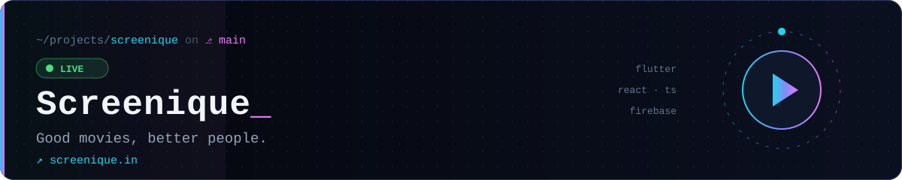

<div align="center">



<br/>

[](https://www.linkedin.com/in/vishal-mache-10ba4632b/)
[](https://screenique.in)
[](https://github.com/VishalMache)


</div>

## `❯ whoami`

```yaml
name:     Vishal Mache
role:     Mobile & Full-Stack Developer
location: India
focus:    [apps end to end, AI systems that do something useful]
building: Screenique  # most of my time goes here
```

## `❯ ./currently-building`

<a href="https://screenique.in"></a>

## `❯ ls ~/projects`

| repo | what it does | stack |
|---|---|---|
| [`idea-hunter`](https://github.com/VishalMache/Idea_hunter) | Evidence-first research engine that finds and scores real product opportunities | `python` |
| [`ctms`](https://github.com/VishalMache/CTMS) | Campus training and placement management platform | `react` `node` `prisma` |
| [`syncme`](https://github.com/VishalMache/SyncMe) | Real-time location sharing and group coordination app | `flutter` |
| [`cyphex-cli`](https://github.com/vedant91/Cyphex_CLI) | AI security scanner for the command line | `python` |
| [`innovare-ieee`](https://github.com/VishalMache/innovare-ieee) | Website for the Innovare IEEE chapter: projects, timeline, team and join page | `nextjs` `supabase` |

## `❯ cat stack.json`

<div align="center">


</div>

## `❯ git log --stats`

<div align="center">
  
  
  <br/>
  
  <br/>
  
</div>

## `❯ ping vishal`

```bash
$ open https://www.linkedin.com/in/vishal-mache-10ba4632b/   # got an idea? let's build it
```

[](https://www.linkedin.com/in/vishal-mache-10ba4632b/)


